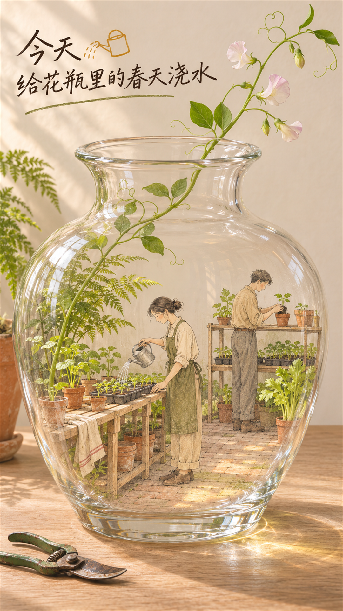
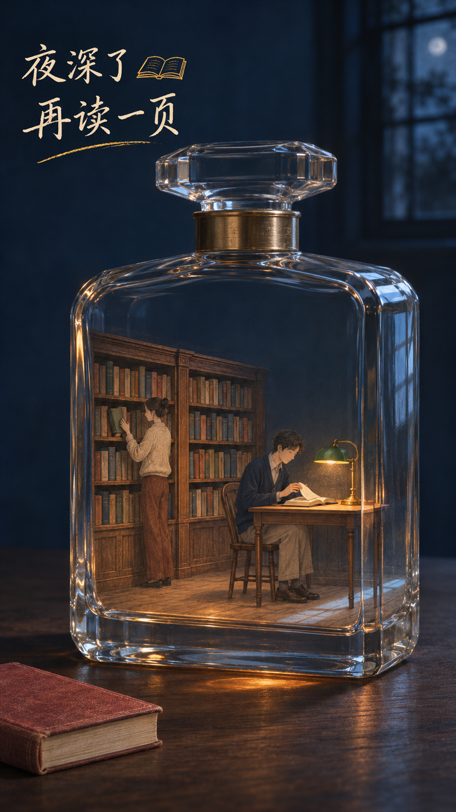
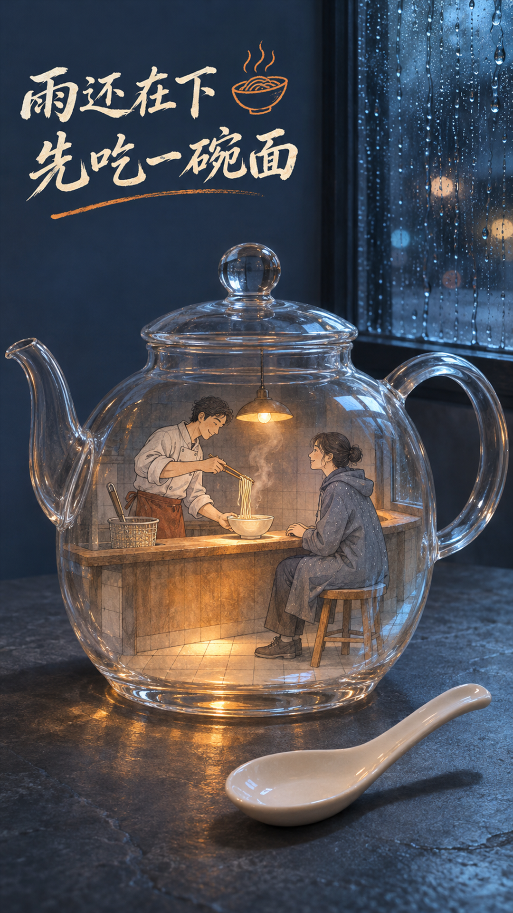
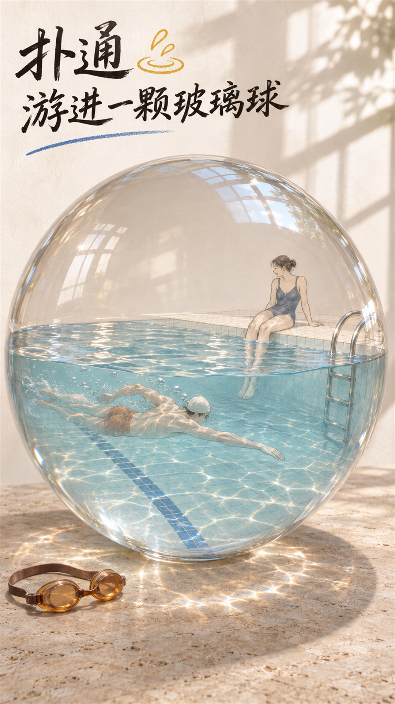
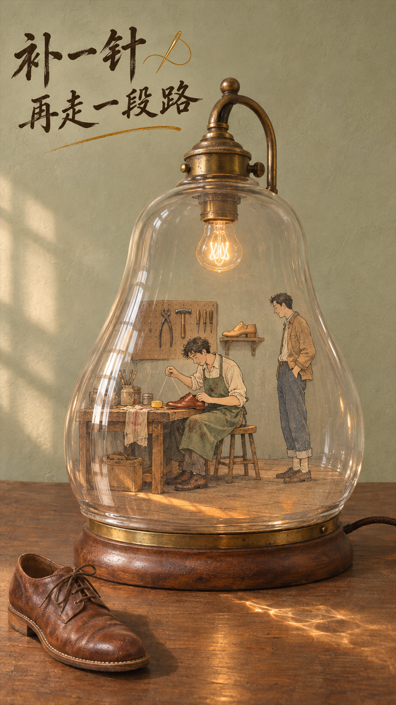

# 玻璃里的小世界

桌上是一只普通花瓶。走近一点，才看见有人提着水壶，在瓶底给春天浇水。

**摄影级透明玻璃 × 手绘微型人物。** 这是一个 Codex 海报 Skill。给它一件玻璃物品和一个想放进去的场所，它会把杯口、瓶底、曲面和水线变成场景的一部分，再让小人进去过日子。

## Install in Codex

**One-command install.** With [Git](https://git-scm.com/install/) installed, open PowerShell on Windows or Terminal on macOS or Linux. Paste this line and press Enter.

```sh
git clone --depth 1 https://github.com/youngfor-shoot/glass-miniature-poster.git "$HOME/.agents/skills/glass-miniature-poster"
```

This installs **玻璃里的小世界** for your current user. Open a new Codex chat, type `$glass-miniature-poster`, and select the skill from the suggestions. You can also paste this example into the chat.

```text
$glass-miniature-poster 把玻璃茶壶做成雨夜面馆。壶里老板给客人盛面，壶外桌上放一只白瓷勺。主文案「下雨了，先吃碗面」，9:16。
```

A brief can specify the vessel, interior use, characters, props, exact Chinese copy, and aspect ratio. The default is **9:16**.

<details>
<summary>Update, install without Git, or fix a missing skill</summary>

**Update an installation made with the command above.** Run this in the same terminal.

```sh
git -C "$HOME/.agents/skills/glass-miniature-poster" pull --ff-only
```

**Install without Git.**

1. On this repository page, choose **Code → Download ZIP** and extract it.
2. Open the extracted `glass-miniature-poster-main` folder. Copy `SKILL.md`, `agents/`, and `references/` into a folder named `glass-miniature-poster` inside your user skills directory. On Windows the parent is `%USERPROFILE%\.agents\skills`. On macOS and Linux it is `~/.agents/skills`. Create the parent directory if needed.
3. Check that `SKILL.md` is directly inside `glass-miniature-poster`. Open a new Codex chat and type `$glass-miniature-poster`.

**If the command says the destination already exists.** Use the update command for a Git installation. For a manual installation, move the previous folder out of the skills directory as a backup, then run the one-command install.

**If Codex does not show the skill.** Check the folder layout in step 3 and restart Codex. [Codex skill locations and discovery](https://learn.chatgpt.com/docs/build-skills#where-codex-loads-local-skills)

</details>

## 成图展廊

点击海报可查看原图。

| 花瓶温室 · 给春天浇水 | 香水瓶里的午夜阅读室 |
| --- | --- |
| <a href="examples/glass-vase-greenhouse.png"></a> | <a href="examples/perfume-bottle-midnight-library.png"></a> |
| 园艺剪留在桌上，花枝探出瓶口。瓶里一个人在浇苗，另一个还在换盆。 | 合上的硬皮书压在桌角。隔着玻璃，绿罩台灯下还有人翻到下一页。 |

| 玻璃茶壶面馆 | 玻璃球泳池 | 玻璃灯罩修鞋铺 |
| --- | --- | --- |
| <a href="examples/glass-teapot-noodle-shop.png"></a> | <a href="examples/glass-sphere-swimming-pool.png"></a> | <a href="examples/glass-lamp-shoe-repair.png"></a> |
| 窗上挂着雨滴，桌上搁着白瓷勺。茶壶里的面馆正端出一碗热面。 | 泳镜留在球外。水里有人划开一道波纹，池边还有人在歇脚。 | 木桌上搁着一只棕色皮鞋。灯罩下，鞋匠一针一线地缝补另一只鞋。 |

## 画面是怎么搭起来的

- **先看瓶外。** 一副泳镜、一把园艺剪，或一本合上的书，给桌面一个现实尺度，也给瓶内的故事埋个线索。
- **沿着玻璃看进去。** 花茎从瓶口伸出去，水线从腿上经过，倒角掠过书架。让近处的玻璃挡住一点、折弯一点，观众就能看出谁在前、谁在后。
- **让瓶里的人有事做。** 比起把家具摆满，一个人弯腰浇水、给客人盛面或就着台灯翻页，就足够让空间活起来。
- **把字当成画的一部分。** 短句分两拍，字有轻重，旁边留给一笔小图标。看[白天版阅读室](examples/perfume-bottle-reading-room.png)如何用瓶外的书袋和两行墨字串起场景。


[Skill instructions](SKILL.md) · [Original visual references and scene recipes](references/scene-recipes.md)
